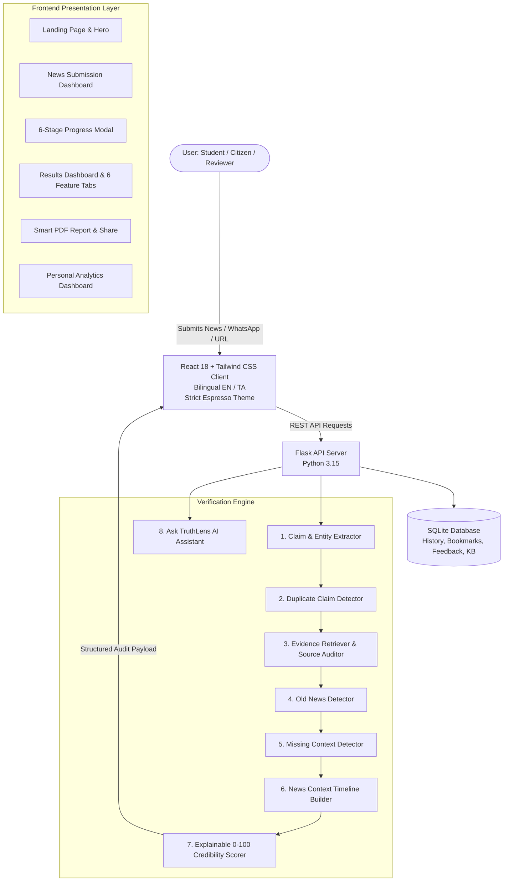

# TruthLens — AI-Powered Intelligent News Verification Platform

> **"Don't Just Read. Verify Before You Believe."**

[](https://react.dev/)
[](https://tailwindcss.com/)
[](https://flask.palletsprojects.com/)
[](https://sqlite.org/)
[](#bilingual-support)
[](#testing)

---

## 1. Project Vision & Overview

**TruthLens** is an intelligent news credibility analysis and fact-verification platform built for students, social media users, and the general public. Guided by the philosophy that information should not simply be labeled with superficial "fake vs real" tags, TruthLens deconstructs submitted text into atomic factual statements, cross-references them against reliable fact-checkers and official government gazettes, identifies recycled outdated alerts, and exposes omitted context.

Users can submit:
- News headlines
- Complete articles
- WhatsApp forwarded messages
- Instagram post captions
- Facebook post text
- News website URLs

---

## 2. Strict Design Identity: Espresso & Cappuccino Theme

TruthLens adheres strictly to an editorial, minimalist SaaS design palette combining warm dark chocolate tones with cappuccino beige highlights:

| Color Role | Hex Code | Usage in Application |
| :--- | :--- | :--- |
| **Espresso Black** | `#171412` | Main page backgrounds, top navigation, and dark canvas |
| **Dark Chocolate Brown** | `#35251E` | Content cards, dashboard panels, verification containers |
| **Coffee Brown** | `#654536` | Subtle borders, dividers, secondary tags, inactive tabs |
| **Cappuccino Beige** | `#C5A98D` | Primary action buttons, active states, score gauge accents |
| **Warm Cream** | `#F2E8DB` | Headings, readable typography, and high-contrast labels |

Harmonized, restrained semantic status tones are used for verdicts to maintain the warm aesthetic without jarring neon colors:
- **Likely Reliable:** Subtle Olive Green (`#5D8A68`)
- **Misleading:** Warm Amber (`#D49B4B`)
- **Likely False:** Terracotta Brick (`#B85347`)
- **Unverified:** Muted Taupe (`#8A8279`)

---

## 3. The Six Innovative Features

TruthLens distinguishes itself through six innovative verification capabilities:

### Feature 1: Claim-by-Claim Verification
Instead of checking an entire article as a single monolithic block, TruthLens isolates each factual assertion. This prevents an article from appearing completely trustworthy just because one of its statements is true.
- *Example:* A forward claims: (1) Heavy rain in Chennai [Reliable], (2) Schools closed tomorrow [Reliable], (3) Government offices closed [False]. Each claim receives its own status, evidence excerpt, and source link.

### Feature 2: Old News & Recycled Announcement Detector
Identifies outdated news or disaster bulletins from previous years being recycled during current events.
- *Example:* Recycled 2022 Cyclone Mandous alert shared in 2026 is flagged with an **Old News Alert**, showing original publication year (2022), time gap (4 years ago), and current verified real-time weather status.

### Feature 3: Evidence Comparison Panel (Side-by-Side)
Provides dual side-by-side columns contrasting **Supporting Corroboration** (official releases, meteorological data) against **Contradicting Rebuttals** (fact-checking debunks, department clarifications) with direct source links.

### Feature 4: Source Reliability & Transparency Audit
Catalogs every source with transparent classification:
- **Primary Official Authority (95–99/100):** IMD, ISRO, District Collectorates, Ministries, WHO.
- **Verified Fact-Checker (90–95/100):** PIB Fact Check, Alt News, BOOM Live, Reuters Fact Check, YouTurn.
- **Established News Media (85–92/100):** The Hindu, Doordarshan, Puthiya Thalaimurai, Times of India.
- **Unverified / Social Source (<60/100):** Anonymous WhatsApp forwards, unverified social media posts.

### Feature 5: Missing Context Detector
Pinpoints when crucial qualifying context has been omitted or inflated:
- Detects geographic inflation (e.g. holiday declared for 3 coastal districts, but shared as a statewide shutdown).
- Flags missing dates, out-of-context video cropping, and omitted prerequisites.

### Feature 6: News Context Timeline
Chronological interactive timeline illustrating how a story unfolded:
*Initial Event / Notice → Media Coverage → Viral Misinformation Resurgence → Official Clarification / Fact-Check → TruthLens Verification Timestamp.*

---

## 4. Additional Core & Professional Features

- **Ask TruthLens AI:** Conversational assistant embedded in the results dashboard. Users can ask follow-up questions (*"Why is this misleading?"*, *"Which source supports this claim?"*, *"Explain in simple English/Tamil"*) answered strictly using retrieved evidence.
- **Smart Verification Report:** Downloadable and printable PDF audit report formatted with clean print CSS (`window.print()`), plus 1-click clipboard summary copy for WhatsApp/Twitter sharing.
- **Bilingual Engine (English & Tamil - தமிழ்):** Complete UI and verification translation. Users can submit news in Tamil or English and read native claims and explanations.
- **Duplicate News Detection:** Intelligent token and semantic overlap matching that alerts users when an inquiry closely resembles an existing verification in the database.
- **Search History & Bookmarks:** SQLite-backed audit history with full-text search, status filters (Reliable, Misleading, False, Unverified), bookmark toggling, and deletion.
- **Personal Dashboard:** Analytics tracking total news analyzed, credibility distribution ratio bars, average credibility index, and saved reports.
- **Feedback System:** User reporting modal for inaccurate ratings, broken links, or translation improvements.

---

## 5. System Architecture



---

## 6. Project Structure

```text
truthlens/
├── backend/
│   ├── app.py                      # Flask REST API server & static file router
│   ├── database.py                 # SQLite database helper (history, bookmarks, stats)
│   ├── requirements.txt            # Python dependencies (flask, flask-cors)
│   ├── fixtures/
│   │   └── knowledge_base.json     # Verified real-world news claims & fact-checks
│   ├── engine/
│   │   ├── claim_extractor.py      # Multi-lingual claim & entity extraction
│   │   ├── evidence_retriever.py   # Supporting/contradicting evidence & sources
│   │   ├── old_news_detector.py    # Recycled & outdated announcement detection
│   │   ├── missing_context_detector.py # Scope distortion & caveat detector
│   │   ├── timeline_builder.py     # Chronological story evolution builder
│   │   ├── credibility_scorer.py   # 4-pillar explainable 0-100 scoring engine
│   │   └── ai_assistant.py         # Evidence-grounded conversational QA engine
│   └── tests/
│       └── test_backend.py         # Backend unit and integration test suite
├── frontend/
│   ├── package.json                # React 18, Vite, Lucide Icons, Tailwind CSS
│   ├── tailwind.config.js          # Strict Espresso & Cappuccino color tokens
│   ├── vite.config.js              # Vite bundler configuration
│   ├── src/
│   │   ├── App.jsx                 # Top-level state and routing
│   │   ├── main.jsx                # React entry point
│   │   ├── index.css               # Global typography, scrollbars, print styles
│   │   ├── i18n/
│   │   │   └── translations.js     # Full English & Tamil bilingual dictionary
│   │   └── components/
│   │       ├── Navbar.jsx          # Header, logo, language toggle, profile badge
│   │       ├── LandingPage.jsx     # Hero section, feature cards, 4-step workflow
│   │       ├── NewsInputDashboard.jsx # Multi-source input with sample loaders
│   │       ├── AnalysisProgressModal.jsx # 6-stage animated progress tracker
│   │       ├── ResultsDashboard.jsx # Score gauge, verdict banner, feature tabs
│   │       ├── Footer.jsx          # Editorial footer with standards & disclaimers
│   │       ├── innovations/
│   │       │   ├── ClaimByClaimView.jsx        # Feature 1
│   │       │   ├── OldNewsAlert.jsx            # Feature 2
│   │       │   ├── EvidenceComparisonPanel.jsx # Feature 3
│   │       │   ├── SourceReliabilityChecker.jsx# Feature 4
│   │       │   ├── MissingContextDetector.jsx  # Feature 5
│   │       │   └── NewsContextTimeline.jsx     # Feature 6
│   │       └── features/
│   │           ├── AskTruthLensAI.jsx          # Conversational assistant
│   │           ├── SmartReportModal.jsx        # Printable PDF report
│   │           ├── HistoryView.jsx             # Filterable search history
│   │           ├── UserDashboard.jsx           # Personal analytics dashboard
│   │           └── FeedbackModal.jsx           # User feedback submission
├── verify_e2e.py                   # Automated end-to-end verification test suite
└── README.md                       # Complete documentation & demonstration guide
```

---

## 7. Getting Started & Installation

### Prerequisites
- **Python:** 3.10 or higher
- **Node.js:** v18 or higher with npm

### 1. Clone the Repository
```bash
git clone https://github.com/sbnandita/truthlens.git
cd truthlens
```

### 2. Set Up the Backend
```bash
cd backend
python -m pip install -r requirements.txt
python app.py
```
*The Flask backend will start on `http://localhost:5000`.*

### 3. Set Up the Frontend
In a new terminal window:
```bash
cd frontend
npm install
npm run dev
```
*The Vite frontend development server will start on `http://localhost:5173`.*

> **Unified Production Mode:**  
> You can also run `npm run build` in the frontend directory. The Flask server at `http://localhost:5000` will automatically serve the built React application without requiring a separate frontend process!

---

## 8. Automated Testing & Verification

Run the comprehensive unit test suite:
```bash
python -m unittest discover -s backend/tests
```

Run the 10-point end-to-end verification test suite:
```bash
python verify_e2e.py
```

### Verified Test Results
```text
========================================
STARTING TRUTHLENS FULL E2E TEST SUITE
========================================
[PASS] 1. Backend Health Check OK: TruthLens AI Verification Engine
[PASS] 2. Pre-curated Test Samples Loaded: 6 samples available.
[PASS] 3. Feature 1 & 5 Verified: Score=62/100, Claims=3, Missing Context Flagged.
[PASS] 4. Feature 2 & 6 Verified: Old News Flagged (4 years ago), Timeline=5 milestones.
[PASS] 5. Feature 3 & 4 Verified: Side-by-side evidence (1 supp vs 1 contra), Sources=3.
[PASS] 6. Feature C (Tamil Support) Verified: Tamil Headline='தமிழ்நாட்டில் 10 மற்றும் 12-ஆம் வகுப்பு பொதுத்தேர்வுகள் ரத்து என பரவும் போலி தகவல்', Verdict=Likely False.
[PASS] 7. Feature A (Ask TruthLens AI) Verified: Grounded answer returned successfully.
[PASS] 8. Feature E (Duplicate Detection) Verified: Similar claim detected with headline: 'Heavy rainfall warning and school holiday announced for Chennai and coastal districts'.
[PASS] 9. History & Bookmark Verified: Report saved and toggled.
[PASS] 10. User Dashboard Stats Verified: Total Verified=28, Reliable=3, Misleading=14, False=11, Bookmarked=4.
========================================
ALL 10 E2E AUTOMATED VERIFICATIONS PASSED!
========================================
```

---

## 9. Academic & Presentation Guide

TruthLens was engineered as an intermediate-to-advanced collegiate computer science and AI software engineering project. 

### Key Presentation Talking Points:
1. **Explainable AI vs Black-Box Classifiers:** Instead of returning a raw probability number, TruthLens provides transparent 4-pillar breakdown indicators (Evidence Quality, Source Authority, Context Freshness, Claim Consistency).
2. **Atomic Claim Extraction:** Prevents cognitive bias where readers assume an entire message is authentic because the first sentence happens to be true.
3. **Temporal Awareness:** Solves the widespread real-world phenomenon of "recycled rumors" by separating event creation dates from current circulation dates.
4. **Bilingual Accessibility:** Demystifies digital misinformation in regional languages (Tamil) with culturally relevant test cases (such as localized monsoon alerts and board examination clarifications).

---

## 10. License

This project is licensed under the MIT License — open for academic evaluation, student research, and non-commercial educational deployment.
